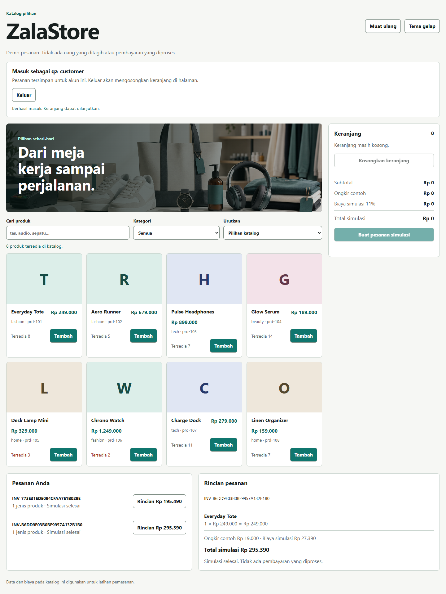

# ZalaStore

Katalog delapan produk dengan keranjang, pesanan simulasi, rincian pesanan per akun, dan ringkasan admin. Frontend memakai HTML/CSS/JavaScript; backend memakai PHP native dan file JSON lokal. Tidak ada pembayaran atau koneksi Midtrans/Stripe.

Warna teal, katalog, dan gambar berasal dari proyek lokal. [NOTICE](NOTICE.md) mencatat batas informasi asal source dan gambar.



[Tampilan ponsel dengan tema gelap](docs/screenshots/mobile-dark.png) dan [ringkasan admin](docs/screenshots/admin-summary.png) diambil dari aplikasi yang sama. Semua akun dan pesanan pada gambar adalah fixture pengujian. [Catatan pengambilan](docs/SCREENSHOTS.md) menjelaskan kondisi dan batas buktinya.

## Menjalankan

Gunakan PHP 8.5 64 bit. Runtime yang dipakai untuk verifikasi adalah PHP 8.5.12 CLI NTS. JSON, session, random bytes, dan bcrypt tersedia pada runtime tersebut. Composer, Node, dan server database tidak diperlukan untuk menjalankan aplikasi.

Dari folder proyek, jalankan PowerShell:

```powershell
$zalaTemp = Join-Path $PWD 'var/tmp'
New-Item -ItemType Directory -Path $zalaTemp -Force | Out-Null
php -n -d memory_limit=128M -d "sys_temp_dir=$zalaTemp" -S 127.0.0.1:8080 -t public public/router.php
```

Buka `http://127.0.0.1:8080`. Jika PHP belum ada di PATH, ganti `php` dengan path lengkap executable PHP Anda. PHP development server ini ditujukan untuk pengujian lokal.

Klik **Buat akun baru** untuk membuat akun pelanggan, lalu tambahkan produk dan buat pesanan simulasi. Username 3 sampai 32 karakter memakai huruf, angka, titik, garis bawah, atau tanda hubung; username dinormalisasi menjadi huruf kecil. Password minimal 12 karakter, maksimal 72 byte UTF-8. Tidak ada akun atau password bawaan.

Harga dan stok dihitung dari katalog server. Ongkir Rp19.000 dan biaya 11% adalah angka contoh untuk simulasi, bukan ketentuan pajak atau penawaran ongkir. Keranjang hanya disimpan dalam memori halaman dan hilang jika halaman ditutup/dimuat ulang. Pesanan yang tersimpan dapat dibuka lagi setelah masuk dengan akun yang sama.

## Admin dan reset lokal

Pendaftaran dari browser selalu membuat akun pelanggan. Admin hanya dapat dibuat melalui CLI operator. Pada PowerShell, ambil password melalui prompt tersembunyi lalu berikan lewat environment sementara:

```powershell
$zalaSecret = Read-Host 'Password admin baru' -AsSecureString
$zalaPointer = [Runtime.InteropServices.Marshal]::SecureStringToBSTR($zalaSecret)
try {
    $env:ZALA_ADMIN_PASSWORD = [Runtime.InteropServices.Marshal]::PtrToStringBSTR($zalaPointer)
    php -n bin/console.php admin operator
} finally {
    Remove-Item Env:ZALA_ADMIN_PASSWORD -ErrorAction SilentlyContinue
    [Runtime.InteropServices.Marshal]::ZeroFreeBSTR($zalaPointer)
    $zalaSecret.Dispose()
}
```

Admin melihat jumlah jenis produk, sisa stok, dan jumlah pesanan simulasi. Tidak ada editor produk, manajemen pembayaran, atau pengubahan role melalui browser.

Untuk mengulang demo, hentikan server terlebih dahulu:

```powershell
php -n bin/console.php reset --confirm
```

Tool meminta Anda mengetik `RESET`, menyimpan cadangan JSON di direktori data, lalu mengembalikan katalog/stok awal dan menghapus pesanan beserta kuncinya. Akun dipertahankan. Gagal membuat cadangan membatalkan reset. Endpoint reset global dan webhook pembayaran dari source lama tidak tersedia.

## Penyimpanan dan akses

Data, session, log, dan cadangan berada di `var/`, di luar `public/` dan diabaikan Git. Untuk lokasi data lain, set `ZALA_DATA_DIR` ke direktori di luar `public/`. Jangan menyalin snapshot data kerja ke repository.

Identitas berasal dari session cookie HttpOnly/SameSite=Strict. Cookie memakai Secure jika origin HTTPS. Login mengganti session ID; setiap request membaca kembali role akun dari penyimpanan. Mutasi memerlukan origin yang sesuai dan token CSRF. Header `X-User-Id` atau `X-Role` tidak digunakan. Router hanya menyajikan file publik yang ditentukan dan tidak meneruskan source, `var`, `.env`, atau metadata Git sebagai file statis.

Secara default host hanya `localhost`/loopback. `ZALA_PUBLIC_ORIGIN`, bila dipakai, harus berisi origin HTTP(S) yang persis sesuai host dan port deployment. Pengaturan itu tidak menjadikan development server sebagai server produksi.

Satu lockfile melindungi seluruh pembacaan/perubahan stok, pembuatan pesanan, dan penyimpanan. Penulisan menggunakan file sementara lalu rename pada filesystem yang sama. Ini ditujukan untuk satu host; bukan database terdistribusi atau jaminan pemulihan saat listrik terputus. JSON rusak menghasilkan kesalahan dan tetap dipertahankan untuk pemulihan, bukan diganti otomatis dengan seed.

Setiap checkout mempunyai key yang terikat ke pemilik dan isi keranjang. Retry dengan key/isi sama mengembalikan pesanan yang sama; isi berbeda ditolak. Key disimpan bersama pesanan tanpa kedaluwarsa otomatis. Batas demo adalah 100 akun, 1.000 pesanan, dan file data 8 MiB; kapasitas penuh menolak write baru tanpa menghapus akun, riwayat, atau key lama. Reset operator yang dicadangkan adalah tindakan terpisah dan eksplisit.

Checkout baru yang berhasil dibatasi tiga per akun dalam 30 detik. Replay pesanan yang sudah tersimpan tetap dapat dibuka saat batas itu penuh. Percobaan login/pendaftaran dibatasi 20 per alamat koneksi dalam lima menit. Alamat proxy dari header klien tidak dipakai.

Jika hasil checkout belum terkonfirmasi, pilih **Periksa pesanan ini**. Halaman mempertahankan key dan isi permintaan, mengunci perubahan keranjang, dan tidak membuat key baru secara otomatis. Jika halaman sudah dimuat ulang sehingga key tidak ada lagi di memori, periksa riwayat pesanan akun sebelum menyusun keranjang dan membuat pesanan lain. Jika pesanan berhasil tetapi refresh katalog gagal, status tetap menjelaskan bahwa pesanan sudah tersimpan.

## API dan alur kode

| Route | Fungsi |
| --- | --- |
| `GET /api/session` | User aktif dan token CSRF |
| `GET /api/products` | Katalog publik |
| `POST /api/register`, `POST /api/login`, `POST /api/logout` | Siklus akun/session |
| `GET /api/orders` | Pesanan pemilik session |
| `GET /api/invoices/INV-…` | Rincian satu pesanan milik akun aktif |
| `POST /api/checkout` | Pesanan simulasi; header `Idempotency-Key`, body `items` dengan ID dan qty integer |
| `GET /api/admin/summary` | Ringkasan untuk role admin dari server |

POST memakai JSON, header `Origin` sesuai origin aplikasi, dan `X-CSRF-Token` dari session. Body dibatasi 64 KiB. [CODE_FLOW](docs/CODE_FLOW.md) memetakan handler, domain, lockfile, dan batas penyimpanan ke source sebenarnya.

## Pengujian

Untuk unit domain tanpa server, sediakan direktori sementara di drive data:

```powershell
New-Item -ItemType Directory -Path D:/uji-zala -Force | Out-Null
php -n -d memory_limit=128M tests/domain.php D:/uji-zala
php -n -d memory_limit=128M tests/concurrency.php D:/uji-zala
```

Direktori induk tersebut harus sudah ada. Tes membuat subdirektori acak sendiri dan menyimpan fixture di sana agar kegagalan dapat diperiksa. Jangan menunjuk data aplikasi sebagai fixture.

Verifikasi pada Windows dengan PHP 8.5.12 CLI NTS:

| Pemeriksaan | Hasil dan cakupan |
| --- | --- |
| Lint PHP dan syntax JavaScript | Lulus pada seluruh source PHP dan `public/app.js` |
| Domain, satu proses PHP | 59 pemeriksaan: bcrypt nyata, validasi, harga server, pemilik pesanan, kapasitas, korupsi JSON, dan backup reset |
| Konkurensi, proses PHP terpisah | 5 pemeriksaan dengan 20 worker, maksimal empat serentak: perubahan tidak hilang, stok tidak oversold, retry key yang sama membuat satu pesanan |
| HTTP nyata | 83 pemeriksaan: session, CSRF/origin, role/pemilik, kontrak JSON, path privat, replay, batas laju, serta reset CLI |
| Chrome dan server PHP nyata | 45 pemeriksaan: akun, filter/sort/cart, invoice, admin, tema, keyboard, fallback tanpa JavaScript, dan lebar 320/390/720/1440 CSS px |

Uji HTTP juga menahan file JSON dengan handle Windows yang menolak rename: write menghasilkan 503 dan mempertahankan byte lama; retry key yang sama berhasil setelah handle dilepas. Uji browser membuang respons checkout setelah server benar-benar menyimpan order, kemudian memastikan retry tidak menggandakan pesanan. Kegagalan refresh setelah sukses dan respons invoice yang datang terlambat turut diperiksa.

Runner domain dan konkurensi tersedia di `tests/`; runner HTTP/browser digunakan sebagai harness verifikasi lokal terpisah. Uji proses paralel memakai `proc_open`, bukan mengandalkan development server PHP yang melayani request secara berurutan pada Windows. Pemeriksaan kontras mengukur sampel teks dan batas kontrol pada kedua tema; ini bukan pernyataan audit aksesibilitas menyeluruh. Lebar 720 px memeriksa reflow yang setara dengan ruang CSS pada jendela 1440 px berzoom 200%, bukan bukti pengoperasian zoom browser.

## Struktur

```text
public/            HTML, JavaScript, CSS, router allowlist, gambar lokal
src/               Store JSON, Service akun/pesanan, tipe kesalahan
seed/catalog.php   Delapan produk awal tanpa data akun/pesanan lama
bin/console.php    Pembuatan admin dan reset operator
tests/             Pemeriksaan domain, konkurensi, dan worker PHP
docs/              Alur kode dan bukti yang sudah diverifikasi
var/               Data/session/log/backup lokal; tidak masuk Git
```
