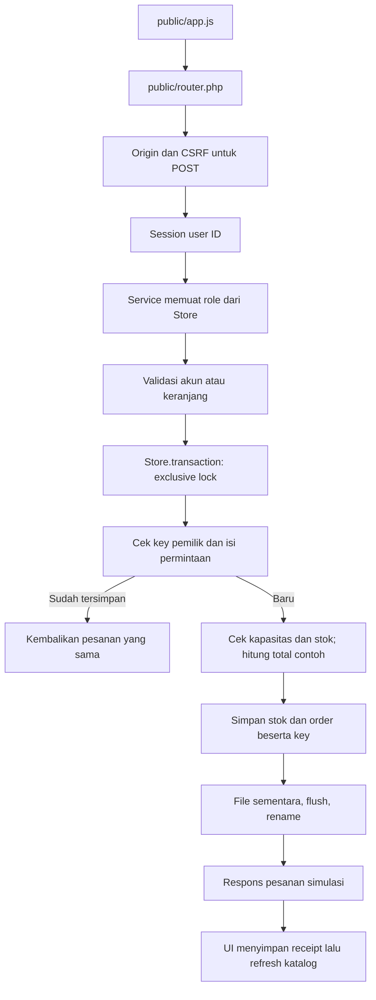

# Alur kode ZalaStore

[`router.php`](../public/router.php) hanya menyajikan index, CSS, JS, dan gambar yang ada dalam allowlist. Source/domain/runtime berada di luar `public`. Host/origin diperiksa sebelum API. POST perlu JSON, origin yang sama, dan token CSRF; body di atas 64 KiB ditolak.

[`app.js`](../public/app.js) memulai dengan `/api/session`, lalu katalog dan pesanan akun aktif. Pendaftaran browser memanggil `Service.register()` tanpa flag admin. Login memverifikasi bcrypt lalu mengganti session ID/CSRF. Role tidak berasal dari checkbox, body, atau header klien. Logout mengganti session anonim dan UI menghapus cart/order/invoice yang berada dalam memori.

[`Service`](../src/Service.php) membaca role dari data server untuk ringkasan admin. Daftar pesanan dan invoice diperiksa terhadap user ID session; invoice milik akun lain menghasilkan 404. Tidak ada integrasi pembayaran atau webhook. Status pesanan adalah `simulation_complete`.

Checkout menormalkan ID unik dan qty integer, lalu mengurutkan cart untuk hash permintaan. [`Store`](../src/Store.php) memegang lockfile stabil selama baca, cek stock/key, perubahan, validasi akhir, dan penggantian file. Harga berasal dari produk server. Rate checkout baru dan key/order berada dalam data yang sama. Retry key pemilik yang sama dilayani sebelum pemeriksaan kapasitas/rate baru; key itu dipertahankan selama order disimpan.

Kapasitas penuh menolak write. JSON rusak atau penulisan gagal menghasilkan error dan tidak membuat seed diam-diam. File sementara ditutup sebelum rename; lockfile terpisah tetap sama saat data diganti. Penguncian berlaku pada satu host/filesystem, bukan transaksi lintas mesin atau jaminan crash durability.

UI membangun elemen dengan `createElement`/`textContent`. Form akun dimulai dalam keadaan nonaktif dan input tidak memiliki atribut `name`; JavaScript/sesi yang gagal dimuat tidak membuat browser mengirim kredensial melalui GET native. Request invoice memakai versi agar hasil lama tidak menggantikan pilihan baru. Checkout membekukan cart dan menyimpan key/isi percobaan hingga hasil diketahui. Kegagalan refresh setelah receipt diterima dipisahkan dari kegagalan checkout; write tidak dikirim ulang dengan key baru secara otomatis.

[`console.php`](../bin/console.php) hanya berjalan dari CLI. Admin baru memerlukan secret environment sementara; password tidak diterima sebagai argumen. Reset perlu flag serta konfirmasi `RESET`, membuat backup penuh dahulu, lalu mengembalikan seed sambil mempertahankan akun. Reset tersebut secara eksplisit menghapus order beserta key dari data aktif; cadangannya tetap memuat keduanya. Operator harus menghentikan server sebelum reset. Seed berada di [`catalog.php`](../seed/catalog.php), terpisah dari data lama pengguna.

[`domain.php`](../tests/domain.php) menguji aturan melalui Service/Store dalam satu proses. [`concurrency.php`](../tests/concurrency.php) membuat fixture sendiri dan menjalankan [`worker.php`](../tests/worker.php) sebagai proses PHP terpisah yang bertemu pada barrier. Counter dengan jeda di dalam lock mendeteksi lost update; checkout stok terbatas serta replay serentak menguji penyimpanan dan key yang sama. Fixture tidak memakai direktori data aplikasi.
